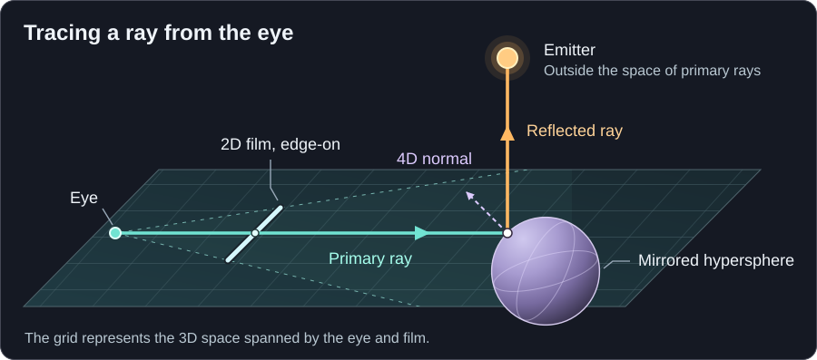

# smallpt4D

## Web app

[WebXR Viewer](https://shizuo-kaji.github.io/smallpt4d/)

Trace light through mirrors and glass in four-dimensional space. Try the scenes on a desktop or phone, or use a WebXR headset to see a separately traced view for each eye.

From the repository root, start the app with Python 3, then [open it in your browser](http://127.0.0.1:8000/).

```sh
python3 -m http.server 8000 --bind 127.0.0.1 --directory docs
```

## The fourth dimension in a mirror



Each eye is a point in 4D space, and its film is a 2D rectangle. Together they span a 3D space containing every **primary ray** from that eye through a pixel. In the diagram, those rays travel along the grid. At the mirror, the **4D surface normal** turns the ray away from the grid and toward a light the eye cannot see directly. The arrows follow the path the renderer traces, from eye to light. Refraction through glass and scattering at diffuse surfaces also take place in all four dimensions.

**Try it in Mirror.** Restore the home view with the crosshair, turn on **Orange emitter**, and set **Bounce limit per path** to **0**. Raise it to **1**. The orange spot that appears in the center of the mirror is the reflection of the hidden light.

## Scenes and controls

| Scene | Try this | What to look for |
| --- | --- | --- |
| Mirror | From the home view, toggle the orange emitter. | Its reflection appears and disappears in the mirror. |
| Glass | Increase the bounce limit from 1 to 2. | The center ray reaches the light after bending at both glass surfaces. |
| Light room | Move the camera along W, the fourth spatial axis. | Mirrors in both W directions show different views of the room. |
| Mirror relay | Increase the bounce limit from 1 to 2. | A small orange reflection appears in the center after the ray hits both mirrors. |
| 24-cell | Set the bounce limit to 0 and rotate from 0° to 45° in the ZW plane. | Each vertex carries a hypersphere. The rotation brings the orange one directly into view. |
| Critical angle | From inside the glass, move the camera's W offset from 0 to −0.30. | The center ray crosses the critical angle and the orange reflection dims. |

- **Desktop and mobile.** Drag to orbit, scroll or pinch to zoom, and select the crosshair to restore the home view. With the viewport focused, use the left and right arrow keys to move along W and the space bar to toggle the emitter.
- **WebXR.** Select **Enter VR**. Move the thumbstick horizontally to travel along W or vertically to rotate in 4D. The trigger toggles the emitter. The left grip changes the rotation plane and the right grip changes the scene.

## Offline renderer and demos

- [Build and run the C++ renderer](cpp/README.md) to render stereo PNG sequences on the CPU or with OpenCL, then combine them into a side-by-side video.
- Explore the [prerendered stereo videos](demo/) and the [illustrated talk on 4D optics](demo/smallpt4d.pdf).
- The [WebGL regression test](tests/transport.html) checks rendered pixels for the mirror, glass, mirror relay, 24-cell, and critical-angle scenes. From the repository root, run `python3 -m http.server 8001 --bind 127.0.0.1`, then [open the test](http://127.0.0.1:8001/tests/transport.html).

Written by Shizuo Kaji. Based on Kevin Beason’s *smallpt: Global Illumination in 99 Lines of C++*. [MIT License](LICENCE)
